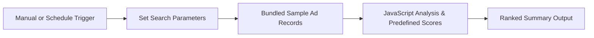

<div align="center">

# 🚀 MySivi — Meta Ad Creative Intelligence Demo
### *n8n prototype: creative analysis using bundled sample ads*

[](https://n8n.io)
[](#)
[](#)

<br/>

> **Built for the MySivi Growth Internship Assignment**  
> *Objective: Prototype a workflow for analyzing Facebook Ad Library creatives. The included workflow demonstrates Hook, Body & CTA analysis and ranking on bundled sample data; it does not fetch live ads or call Gemini.*

<br/>

[📋 Read Executive PDF Report](MySivi_Ad_Intelligence_Report.pdf) • [⚙️ Import n8n Workflow](mysivi_meta_ad_scraper_workflow.json)

</div>

---

## 📌 Executive Summary

This repository contains an n8n prototype for organizing and comparing MySivi ad creatives.

The included workflow uses five ad records embedded in a Code node, applies predefined JavaScript analysis and scores, then ranks the results. It is self-contained for demonstration, but it does **not** scrape the Facebook Ad Library, invoke Google Gemini, or provide live performance data. The diagram shows the behavior of the included workflow:



---

## 🏆 Top Performing Creative Teardown

In the workflow's bundled sample data, **Ad #1 ranks highest**. These figures are illustrative sample values, not results from a live Ad Library scrape:

<div align="center">

| Metric | Details |
| :--- | :--- |
| **Winning Ad ID** | `AD-01` — *"Workplace Meeting Anxiety"* |
| **Resonance Score** | **`9.4 / 10`** ⭐⭐⭐⭐⭐ |
| **Primary Demographic** | Salaried IT & Corporate Professionals (Tier-1 Tech Hubs) |
| **Meta Ad Longevity** | **60+ Active Days** (~850k - 1M Impressions) |
| **Key Advantage** | High disposable income + urgent workplace necessity |

</div>

### 🔬 The 3-Part Marketing Framework Breakdown

```
┌────────────────────────────────────────────────────────────────────────────────┐
│ 🎣 THE HOOK (First 2-3 Seconds / Scroll-Stopper)                                │
│ "Stuck while speaking English in office meetings? 🤐"                          │
│ ➜ Visceral call-out targeting the acute professional fear of client ridicule.   │
├────────────────────────────────────────────────────────────────────────────────┤
│ 💡 THE BODY (Agitation & Non-Judgmental AI Solution)                           │
│ "Most working professionals freeze when it's time to speak in front of clients.│
│  Meet MySivi — India's 1st AI English Tutor. Practice real office convos 1-on-1│
│  without judgment. Just 15 minutes a day, zero embarrassment!"                 │
│ ➜ Completely removes the #1 psychological hurdle: fear of being laughed at.    │
├────────────────────────────────────────────────────────────────────────────────┤
│ 🎯 THE CALL TO ACTION (CTA)                                                    │
│ "Install Now — Start your free 7-day fluency trial!"                           │
│ ➜ Frictionless entry with instant trial gratification.                         │
└────────────────────────────────────────────────────────────────────────────────┘
```

---

## 📊 Side-by-Side Sample Creative Comparison

The following comparisons and scores are predefined in the bundled demo data; they are not independently verified live campaign results.

| Creative | Hook (Opening 2-3s) | Core Value Proposition | CTA | Score | Status |
| :---: | :--- | :--- | :---: | :---: | :---: |
| **#1** | *"Stuck while speaking English in office meetings? 🤐"* | 1-on-1 AI workplace roleplay; zero judgment; 15 mins daily | **Install Now** | **9.4 / 10** | 🏆 **WINNER** |
| **#2** | *"Cracking job interviews requires more than technical skills."* | AI mock interviews (HR & Tech); target 2x salary jump | **Download** | **8.8 / 10** | 🥈 Runner-Up |
| **#3** | *"English coaching classes take 3 months and cost ₹15,000+."* | Contrast ₹15k offline fee vs ₹499/mo 24/7 personal smartphone AI | **Try Free Demo** | **8.5 / 10** | 🥉 Strong Angle |
| **#4** | *"Maine socha tha English seekhna bohot tough hai..."* | Hinglish UGC review by Priya clearing client interview rounds | **Learn More** | **9.1 / 10** | High UGC CTR |
| **#5** | *"Limited Time Offer! 🚀 50% OFF on Annual Fluency Pass."* | Direct discount pricing urgency expiring Sunday midnight | **Get Offer** | **7.2 / 10** | Retargeting Only |

---

## 💡 Strategic Recommendations to Reach ₹500 Cr ARR

### 1. Dynamic Hook Branching
Use the sample-data winner (Ad #1) as a hypothesis to test. Branch the opening 3 seconds into 4 micro-segments while keeping the solution body intact:
- **Variant A (IT Engineers):** *"Dreading your daily client standup tomorrow?"*
- **Variant B (Job Seekers):** *"Clear the technical round, but freeze in the HR English round?"*
- **Variant C (Tier 2/3 Aspirants):** *"English samajh aati hai par bolne me hesitation hoti hai?"*
- **Variant D (Managers):** *"Leading meetings with international clients?"*

### 2. CAC-Slashing Lead Magnet Funnel
Instead of directing cold traffic straight to the App Store install page, route users to a **60-Second In-Browser AI Voice Assessment**:
- The user speaks 3 sentences into their browser microphone.
- AI instantly generates their **CEFR English Fluency Score (A2 / B1 / B2)**.
- To view their customized diagnostic breakdown, they download the MySivi App.
- **Estimated impact:** 25% to 35% higher ad-to-install conversion rate.

### 3. Future: Automated Ad Fatigue Radar
The current workflow does not monitor live ad flight times, check CTR, or send Slack notifications. Those could be added as a future extension using a live data source and notification integration.

---

## 🛠️ How to Run in n8n

1. Open the published workflow in your n8n workspace, or import [`mysivi_meta_ad_scraper_workflow.json`](mysivi_meta_ad_scraper_workflow.json) into n8n.
2. Click **Execute workflow** and choose the **Manual** trigger.
3. Open **Output Results & Summary** to inspect the five sample ads and their ranking.

No API credentials are required for this sample-data demo. To use live ads or Gemini, replace the sample and JavaScript analysis nodes and configure the required credentials in n8n. Do not put API keys in this repository.

The winning score is available at `winningAd.performanceScore` (9.4 in the bundled sample). The current `winningReason` text may display `undefined/10` because of a field-name mismatch; use the score field for the numeric result.

---

## 📂 Project Directory Structure

```text
├── 📄 MySivi_Ad_Intelligence_Report.pdf     # Publication-grade analytical teardown
├── ⚙️ mysivi_meta_ad_scraper_workflow.json    # Complete n8n importable workflow
├── 📊 sample_scraped_ads.json                 # Formatted Meta Ad Library dataset
├── 🐍 generate_pdf_report.py                 # ReportLab compilation script
```

---

<div align="center">

**Built with passion for high-intensity growth engineering & AI automation.**  
Ready for 6 days in-office execution at HSR Layout, Bengaluru! 🚀

</div>
